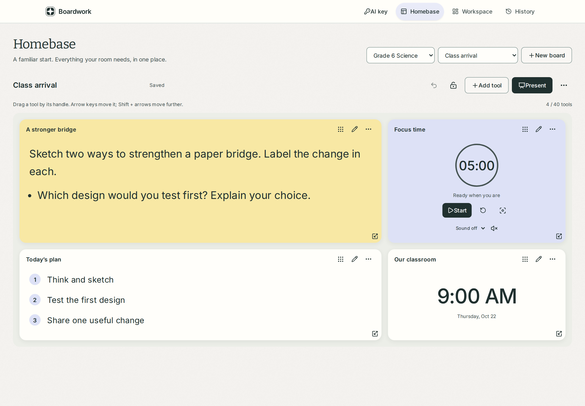
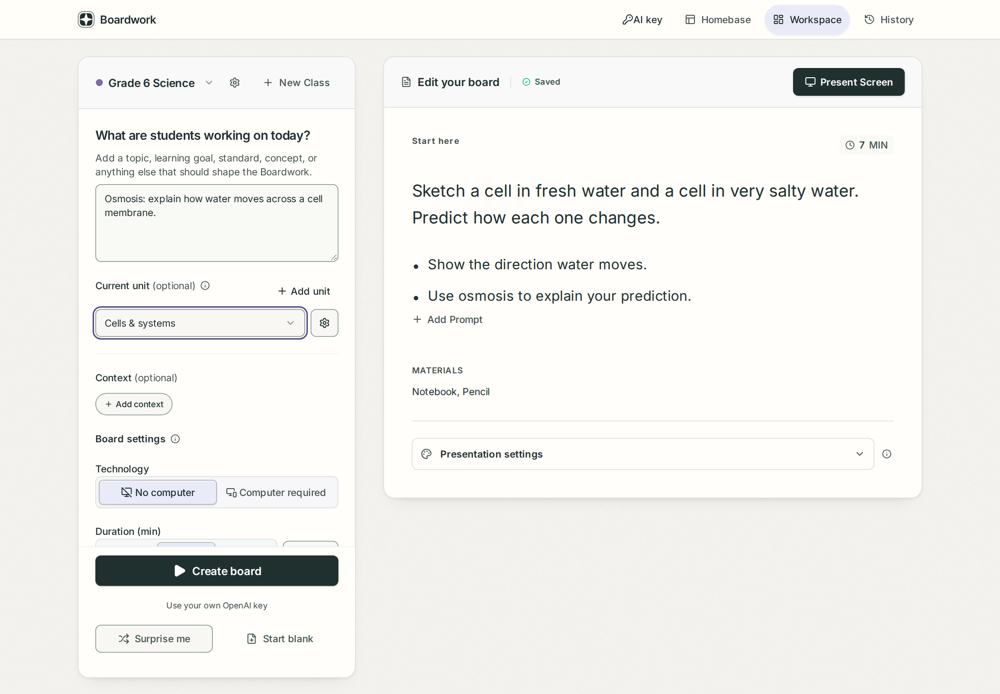
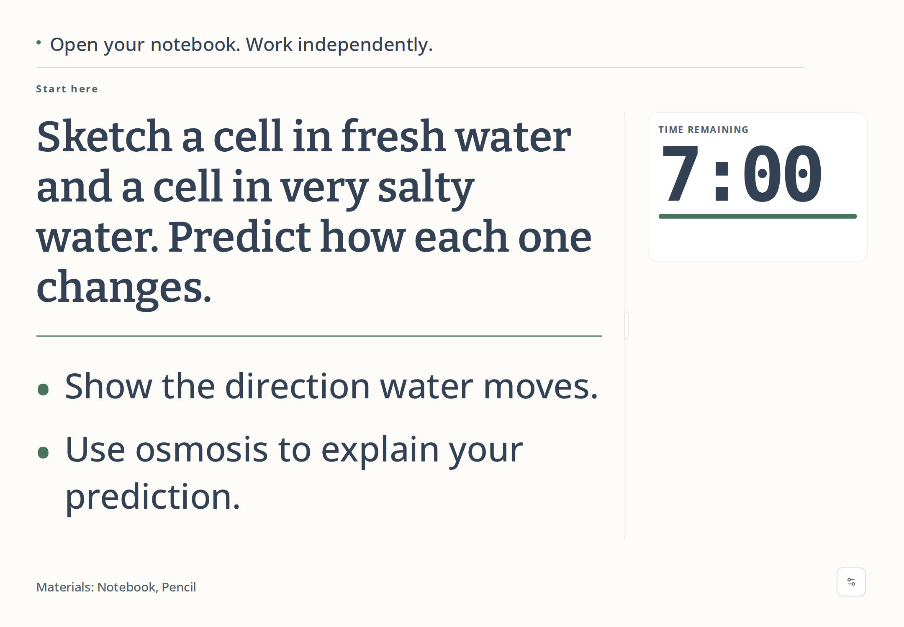
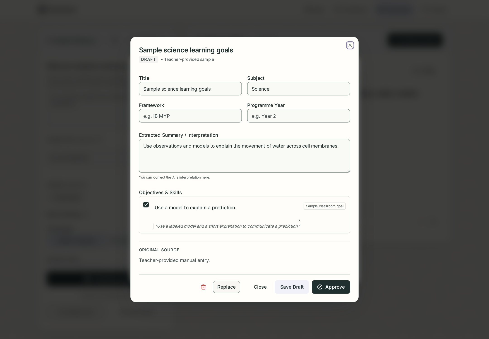

# Boardwork

**An education tool for creating clear classroom activities and keeping everyday teaching tools in one place.**

Boardwork turns class context into editable student tasks and reusable classroom displays. It began with start-of-class activities and has grown into a classroom Homebase for tasks, timers, agendas, notes, and resources.

An independent product by **Jason Arsenault**, developed from the practical constraints of teaching.



*A saved Homebase keeps the task, time, and routine together. Teachers can rearrange the layout, lock it, and switch to a clean presentation.*

[Product decisions](#design-decisions) · [Technical approach](#technical-approach) · [Run locally](#run-locally) · [Project documentation](#project-documentation)

## The problem

A teacher may be welcoming students, taking attendance, and preparing materials at the same time. Students still need to know what to do, how to begin, and how long they have. Finding instructions and switching between slides, timers, and other tools competes for the teacher's attention.

The design connects two needs: reusable preparation for teachers and a clear next action for students. Instructional judgment stays with the teacher.

## My role

I lead problem definition, product scope, classroom workflows, interaction requirements, and content expectations. My teaching experience informs the initial requirements; broader user research remains a next step.

I use AI coding tools to develop and iterate the implementation and tests. My focus is translating user needs into a working experience, making tradeoffs, and refining the result. The onboarding, recovery flows, and documentation also reflect my experience helping people learn and adopt unfamiliar tools.

## From preparation to the classroom

### 1. Remember the context; edit the task

Class profiles, units, and saved context reduce repeated setup. Today's topic, time, and device requirements shape the activity. Teachers can draft with AI or start blank, then edit directly.



*Preparation controls stay beside the result, so an almost-right draft can be corrected directly.*

### 2. Give students a clear next action

Presentation prioritizes the task, prompts, and time. Teacher-only notes stay out of the student view and PNG export. History supports reopening, favorites, duplication, and adaptation.



*A student display with a live timer; a separate 1920 × 1080 PNG export fits into existing slide decks.*

### 3. Make AI context reviewable

Optional curriculum setup accepts teacher text and readable PDFs, plus discovery for supported public publisher sources. Interpretations begin as drafts. Teachers review the summary, objectives, excerpts, and applicability before approval.



*Approval makes context eligible for future generation. It does not certify curriculum compliance or guarantee factual accuracy.*

Screenshots show the actual interface with illustrative content, not real student records or evidence of AI output quality. The curriculum view illustrates a protected setup. [Capture details](docs/screenshots/README.md).

## Design decisions

| User constraint | Product response | Reasoning |
| --- | --- | --- |
| Teachers switch between classes with little preparation time. | Remember class context, defaults, units, and multiple named Homebases. | Keep useful setup available for the next lesson. |
| Students need instructions while the teacher is occupied. | Use direct task language, a distinct presentation view, and visible timing. | Make the first action and time available easy to find. |
| A draft may need one correction. | Make generated text editable; retain a blank-start path. | Keep the teacher in control. |
| A classroom display serves a different audience from an editor. | Separate teacher notes and controls from student content. | Support preparation without placing that complexity on the projected board. |
| Dragging and small screens can make layout work difficult. | Provide keyboard layout controls, focus restoration, and stacked phone layouts. | Offer alternatives to precise pointer interaction. |
| A failed save should not erase preparation. | Retain Homebase drafts and offer a copy when revisions conflict. | Recover work without silently overwriting another version. |

Classroom projector feedback identified crowded, small prompts despite unused space. That led to larger, more widely spaced prompts, with a compact treatment for long activities. [Verification notes](docs/TESTING.md) distinguish that classroom observation from browser checks.

## Implemented scope

- **Activity workspace:** saved classes, units, and context; AI or blank drafting; editing and autosave; History, favorites, duplication, presentation, and PNG export.
- **Classroom Homebase:** multiple boards, starting layouts, movable/resizable tools, lock, undo, duplication, presentation, and timer-only focus.
- **21 tool types:** timing with optional ambient sound, notes and agendas, participation tools, drawing, and linked media. See the [tool inventory](docs/HOMEBASE.md).
- **Reviewed curriculum context:** class- and unit-scoped sources, draft/approval lifecycle, and a stored source snapshot for generated activities.
- **Optional AI:** bring your own OpenAI key, held in memory until refresh, with visit token usage. Editing and presenting saved work need no key.

Published Google Docs, Slides, and Sheets embeds work where providers permit them. Private account imports, remote student voting, live weather/news, teacher accounts, and billing are future work. This is a single shared teacher installation; the host supplies access protection.

## Technical approach

The application uses **React, TypeScript, Vite, Tailwind CSS, an Express API, PostgreSQL, Drizzle migrations, and shared Zod validation**. Docker Compose runs the app and database without the original hosting platform.

- **AI boundaries:** structured responses, Zod validation, bounded repair, and validated-only saves. These checks do not establish instructional quality.
- **Persistence:** Homebase saves are serialized and checked against an expected revision. Stale writes are rejected; a local recovery draft remains available.
- **Audience separation:** presentation and export exclude teacher notes; Homebase task copies are independent of the original activity.
- **Resource control:** external media loads on request with an open-in-new-tab fallback. Private curriculum requires host-level access protection; BYOK is not authentication.

Verification includes component tests, browser scenarios for layout, timers, focus, and save recovery, and a [passing Docker/PostgreSQL smoke run](https://github.com/whatifqu3stion/classroom-spark/actions/runs/39900573693). See the [test record](docs/TESTING.md) and [Homebase notes](docs/HOMEBASE.md) for limits.

## What I would validate next

The priority is a teacher-reviewed AI evaluation set covering correctness, age appropriateness, first-action clarity, time, materials, and sparse context. It should support repeatable prompt and pipeline comparisons.

Broader trials should measure time to a usable activity, editing required, repeat use, and whether students can begin independently. Homebase needs physical projector and device checks. These are evaluation plans, not proven time savings or learning gains.

## Run locally

With Docker and Compose v2 installed:

```sh
cp .env.example .env
# Set a strong POSTGRES_PASSWORD in .env; leave visitor OpenAI keys out.
docker compose up --build --detach --wait
```

Open **http://localhost:8080**. Create a class and **Start blank**, or add a key through **AI key** to generate. The installation uses a fresh database and persistent volumes.

See the [standalone guide](docs/STANDALONE.md) for development without Docker, operations, and access protection; see [BYOK details](docs/BYOK.md) for key handling and usage accounting.

## Project documentation

| Area | Details |
| --- | --- |
| Product definition | [Original MVP and subsequent expansion](docs/PRODUCT.md) |
| Interaction and visual design | [Design specification](docs/DESIGN.md) |
| Classroom tools and saving | [Homebase](docs/HOMEBASE.md) |
| AI and source review | [Generation brief](docs/AI_GENERATION.md) · [Curriculum implementation](docs/CURRICULUM.md) |
| Architecture and deployment | [Technical specification](docs/TECHNICAL.md) · [Standalone setup](docs/STANDALONE.md) |
| Evidence and limits | [Verification record](docs/TESTING.md) |
